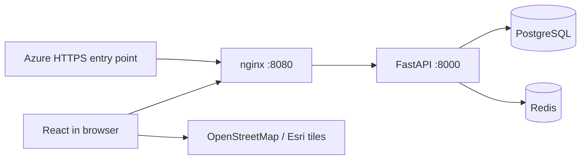

# Architecture

Updated: 11 October 2026.

## Current presentation and analytics flow

`main.jsx` renders the approved **Find your space. Build your future.** homepage headline as live text. `admin.jsx` opens Analytics by default and keeps management navigation above each section. Native SVG charts and `ResizeObserver` in `analytics.jsx` size the full-width third-row activity plot without stretching labels; `analytics.css` supplies compact spacing, light shadows and reduced-motion-aware KPI hover feedback.

The admin-only analytics router reads PostgreSQL aggregates and returns private, no-store responses. Browser verification creates an authentication session but writes no business records. Reporting windows are 30/90/365 India calendar days with daily/7-day/30-day event totals; account/agent charts retain whole-portal scope. See [metric definitions](ADMIN-ANALYTICS.md). `demo_pricing.py` provides deterministic direct-INR seed assumptions and guarded explicit repricing, as described in [handoff](HANDOFF.md#indian-demo-price-update--11-october-2026).

React 18 and Vite build static assets served by unprivileged nginx. The same origin proxies `/api/*` to FastAPI. PostgreSQL and Redis have no host ports. Backend containers run as a non-root user. The only local host binding is `127.0.0.1:8090`.

## Frontend identity

The shared Logo component in `frontend/src/main.jsx` renders RealSite.in as HTML text rather than a wordmark image. `branding.css` defines Inter 900, a blue gradient, light shadow, responsive 26/25/22/20px sizes and a baseline-aligned .in suffix at 80%. The SVG map-pin/house emblem is `frontend/public/realsite-emblem.svg`; the favicon matches it. The standalone tour uses the same live-text structure. Inter is requested from Google Fonts, with Arial fallback. Older bitmap design drafts are archived locally and excluded from the published frontend.

## Persistence

| Table | Purpose |
| --- | --- |
| `users` | Names, unique normalised emails, scrypt password hashes, user/agent/admin role, demo/active flags, mobile, city, biography and owned avatar URL |
| `auth_sessions` | SHA-256 token hashes, account IDs, seven-day expiration |
| `agent_profiles` | Professional details, service cities, phone consent, pending/approved/rejected review state and reviewer |
| `email_changes` | One pending email per account, SHA-256 verification-code hash and 30-minute expiry |
| `account_audit` | Actor/target IDs, action, changed fields, required admin reason and timestamp |
| `properties` | Prices, Indian addresses, coordinates, photos, amenities, owner and demo flags, unique nullable seed key, validated nullable JSON features and previous asking price |
| `uploaded_images` | Account-owned photo IDs, dimensions and timestamps; JPEG files in the persistent image volume |
| `favorites` | Unique account/property pairs |
| `saved_searches` | Account-owned validated search criteria |
| `inquiries` | Sender, property, message, phone, requested visit date |

Schema creation uses SQLAlchemy `create_all` at startup. `app/migrations.py` applies additive role, demo-account flag, property seed-key, listing-type fields, `features` JSON and `previous_price` upgrades to existing databases and preserves existing rows. Existing buyer and seller roles become `user`, retaining their data and allowing both buying and selling. It also adds compatible profile/active columns and creates the account-management tables. This small idempotent compatibility migration supports the local demo; introduce versioned Alembic migrations before further schema changes or production rollout.

## Authentication and authorisation

Registration automatically signs the user in. Sessions use random opaque tokens in HTTP-only SameSite=Lax cookies scoped to `/api`. Only token hashes are stored in PostgreSQL. Logout revokes the session and clears its cookie. Cookies are secure in the Azure overlay. Passwords use salted scrypt.

All account-owned reads and writes require a valid session. Registration creates only the `user` role. Every signed-in user can publish and manage their own listings; edits and archival on the owner API require ownership. Favourites and saved searches are scoped to the account. Enquiries are visible to the sender and listing owner, and to administrators via separate protected endpoints. Public listing responses do not include owner email, phone, or enquiry data. Admin endpoints require the admin role on the server and return private, uncached responses.

Known local demo accounts are created only when both seeding and `DEMO_ACCOUNTS_ENABLED` are enabled. Disabling demo accounts rejects both login and existing sessions without deleting data. The Azure overlay disables these accounts. Synthetic inventory uses stable unique seed keys; repeated startups preserve owner edits, archives and user choices. The local seed renames the old demo seller to `demouser`, merges the old demo buyer's properties, favourites, saved searches and enquiries, and removes the obsolete account. Overlapping favourites are combined. Sessions for the renamed or removed accounts are revoked; administrator sessions remain valid. The migration and seed are repeatable and do not reset the new demo password on later starts. See [client demo](DEMO.md).

State-changing browser requests reject cross-origin `Origin` headers and cross-site Fetch Metadata. Request size is bounded by nginx. Input validation constrains coordinates, prices, PIN codes, Indian mobile numbers, image URL schemes, message lengths, and filter values.

## Profile and account administration

`app/accounts.py` implements self-service profiles and current-password-protected credential changes. Email changes keep the old address until a hashed, expiring, single-use code is confirmed. Password/email changes revoke other sessions; suspension revokes all sessions and hides the public agent. Agent applications and professional edits require review before publication. Public registration cannot assign agent/admin roles. Audit records exclude credentials and codes. Local demo verification is explicit; configured SMTP uses TLS, while the Azure overlay forbids demo delivery. See [user management](USER-MANAGEMENT.md) for privacy, constraints and provider setup.

## Listing types and uploads

Residential/commercial properties, plot sale and rental fields share a type-validated listing API. Plot areas retain their entered units and are normalised to square feet. Additive migrations preserve existing listings. React presents separate four-step forms.

Multipart uploads accept JPEG/PNG/WebP up to 5 MB, validate contents with Pillow, resize, orient and strip metadata. Only the uploading owner can attach a photo. PostgreSQL metadata and the property_images Docker volume must be backed up together. nginx permits a 6 MB upload request; other write limits remain unchanged.

## India advanced filters

The additive `features` JSON and `previous_price` columns retain the existing inventory. `app/advanced_filters.py` validates owner-supplied attributes and adds SQL predicates shared by list, map and histogram queries. It supports listing source/category/status, possession/ownership, maintenance, furnishing, parking, property/carpet/plot area, construction year, floors, amenities, views, tours, plot approval/road width, distance, listing age, reductions and keywords. Haversine distance is computed in SQL and is explicitly not travel time. All criteria are included in URL state, saved searches and Redis keys. Updates preserve feature metadata when legacy clients omit it; price changes track the previous asking price. Synthetic metadata is populated once without changing original prices, dates, ownership, images or account activity. See [India filters](MORE-FILTERS.md).

## Redis

Search responses are cached for 60 seconds with keys derived from filters, viewport, pagination, and a listing revision. Create/update/archive increments the revision. If Redis is unavailable, search queries run against PostgreSQL. Readiness requires both PostgreSQL and Redis.

Redis also enforces ten-minute counters for authentication, publication, and enquiries. Authentication and protected rate-limited writes return 503 when Redis is unavailable. Local nginx replaces the client IP header. For multi-proxy public deployments, configure trusted client IP forwarding; the supplied basic Azure overlay otherwise counts requests behind Caddy together.

## API summary

| Method | Endpoint | Access |
| --- | --- | --- |
| GET | `/api/health`, `/api/cities` | Public |
| GET | `/api/properties`, `/api/properties/price-distribution`, `/api/properties/{id}` | Public |
| POST | `/api/auth/register`, `/api/auth/login` | Public, rate limited |
| GET / POST | `/api/auth/me`, `/api/auth/logout` | Session / session revocation |
| GET | `/api/favorites` | Account |
| PUT / DELETE | `/api/favorites/{id}` | Account |
| GET / POST | `/api/saved-searches` | Account |
| DELETE | `/api/saved-searches/{id}` | Owning account |
| GET / POST | `/api/inquiries` | Account |
| GET | `/api/me/listings` | Account, owned listings only |
| POST | `/api/uploads` | Account, multipart photo upload |
| GET | `/api/uploads/{filename}` | Public JPEG |
| POST | `/api/properties` | Account, rate limited |
| PUT / DELETE | `/api/properties/{id}` | Account that owns the listing |
| GET / PATCH | `/api/me/profile` | Owning active account |
| POST | `/api/me/password`, `/api/me/email-change`, `/api/me/email-change/verify` | Owning account, rate limited |
| DELETE | `/api/me/email-change` | Owning account, cancel verification |
| PUT | `/api/me/agent-profile` | Owning account, submits pending application |
| GET | `/api/agents` | Public, approved active profiles only |
| GET | `/api/admin/agents`, `/api/admin/account-audit` | Administrator, paginated |
| PATCH | `/api/admin/users/{id}`, `/api/admin/agents/{id}` | Administrator, reason required |
| GET | `/api/admin/summary` | Administrator |
| GET | `/api/admin/analytics` | Administrator; period/dataset aggregates, private no-store |
| GET | `/api/admin/properties`, `/api/admin/users`, `/api/admin/inquiries` | Administrator, paginated |
| PATCH | `/api/admin/properties/{id}` | Administrator, archive/restore any listing |

Search supports `q`, `polygon`, `boundary_q`, `agent`, `agent_id`, `purpose`, `min_price`, `max_price`, `beds`, `baths`, `beds_match`, `baths_match`, `kind`, `min_sqft`, `amenity`, `sort`, `page`, `page_size`, and optional `north/south/east/west` bounds. Room matching accepts `exact` (equal), `max` (at most) and `min` (at least). Zero means Any. Missing matching modes retain the legacy `min` meaning for existing URLs and saved searches; room choices default to minimum counts (1+, 2+, etc.), with separate exact-match checkboxes. The UI offers plus-count or exact matching only; the API retains maximum matching for existing callers. Room-count searches exclude plots and commercial units. Matching modes participate in saved searches and cache keys. Map queries show up to 100 filtered properties; the list paginates in batches of 24.

Price filtering supports `price_mode=price|payment`, `min_payment`, `max_payment`, `down_pct`, `annual_rate`, `loan_years` and `credit_band` alongside existing list-price bounds. Payment mode computes an amortising loan EMI per asking price in SQL before counting, sorting and pagination. These assumptions participate in cache keys and saved searches. The distribution endpoint aggregates 30 bins over matching active inventory, respecting room/type/location criteria while ignoring price limits. See [price filters](PRICE-FILTER.md). No schema migration is required for these JSON search criteria.

The frontend uses URL query parameters for shareable searches and property details. Recently viewed property IDs are stored locally in the browser. All private saved data resides in PostgreSQL.

## External connections

OpenStreetMap tiles load at runtime for the Automatic map. The Map Options panel can switch to Esri World Imagery satellite tiles; the view keeps its centre, zoom, and property markers. Street view provides a Google Maps panorama link for the current map centre, rather than an embedded panorama API. Climate Risk choices display a data-unavailable status until a suitable India risk feed is integrated; no synthetic risk values or overlays are produced. See [map options](MAP-OPTIONS.md).

Google Fonts is optional and falls back to Arial. The included sample property photographs are served locally. Owner listings support uploaded photos and retain hosted HTTPS images. No payment, SMS or lender service is connected. SMTP support is configurable for email-change verification; the local default displays an explicitly labelled demo code without sending mail. See [listing forms](LISTING-FORMS.md).

## Drawn search boundaries

`SearchFilters.polygon` accepts a validated simple polygon with 3–64 vertices in `[latitude, longitude]` order. `app/map_boundary.py` checks finite coordinates, non-zero area and self-intersections. A bounding rectangle and portable SQL even/odd predicate filter properties before totals, pagination and price-distribution aggregation. Polygon data is included in Redis cache keys and existing saved-search JSON. No schema migration or PostGIS dependency is introduced. React/Leaflet handles pen-first freehand drawing, draggable corner editing and a keyboard alternative; applying clears the active text location and temporary viewport bounds while retaining other criteria. `boundary_q` stores the original location in the URL and saved-search JSON, solely as return context. Removing the polygon restores that location and city map; it does not constrain the polygon query to the original city.

Pen strokes are published at most once per animation frame as a single polyline. Coalesced pointer samples support mouse, touch and stylus events. Samples are simplified after release, then a closed polygon and draggable handles are shown. Map gesture handlers are restored while previewing or using Move map, and when the drawing session ends.

The pen cursor is a local 24x24 SVG at `frontend/public/cursors/pen.svg`, with a 1.25px blue outline and white contrast edge. CSS in `map-draw.css` positions its hotspot at the nib (3,21) and uses a crosshair fallback. It stays a pen while the pointer is held. Move map and the finished preview use a hand; draggable corner handles also use a hand. `stroke-shape.js` trims minor loops only when discarded area stays within 8 percent of the retained shape. `boundary-search.js` manages location restoration and clears return context when a new location starts a search.

## Marker visibility and hover

Search result cards supply their property ID to `PropertyMap.hovered`. Leaflet raises the matching marker and applies its hovered class. `styles.css` renders a 1px cyan border (`#22d3ee`) with a soft glow; mouse leave clears the class. During drawing, `map-draw.css` disables property-marker pointer events while retaining visibility. Preview geometry and draggable boundary handles remain separate layers. Drafting does not change the server search; Apply commits the polygon.

## Administrator analytics

`app/analytics.py` reads scoped inventory metadata, current favourites and two equal-length enquiry windows. India calendar dates are converted to UTC query boundaries. Current stock, archived records and period flows remain distinct; prices use separate sale/rent medians and price bands. The API returns aggregates without private contact/message data and reuses server administrator access. Account/agent aggregates always use the whole portal, explicitly labelled in the UI. No schema migration or third-party chart package is required. React SVG/CSS charts provide focus/hover values and responsive layouts. See [analytics definitions and scaling notes](ADMIN-ANALYTICS.md).

## Synthetic Indian pricing

`app/demo_pricing.py` contains deterministic city/locality/area/type assumptions in INR. `seed.py` uses them only for new seed rows, preserving the original seeded coordinates and dimensions. An explicit preview/apply CLI recognises original `india-demo-v2` records, checks original core facts and amounts, and updates only price/prior price; unknown or edited records are skipped. Applying invalidates the existing Redis listing revision. No schema, currency-conversion service or market-data integration is added. Demo ranges, references and limitations are in [the demo guide](DEMO.md#indian-demo-pricing).

The listing/enquiry activity SVG uses two adjacent bars per reporting bucket, with heights proportional to actual counts and the existing keyboard/hover readout. Account growth retains its line chart; time boundaries and API aggregation are unchanged.
