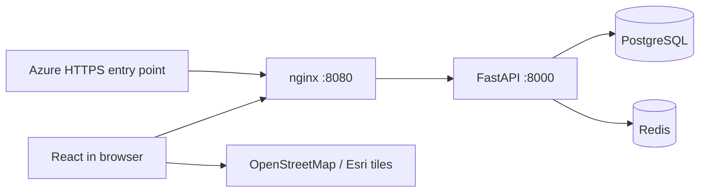

# Architecture

React 18 and Vite build static assets served by unprivileged nginx. The same origin proxies `/api/*` to FastAPI. PostgreSQL and Redis have no host ports. Backend containers run as a non-root user. The only local host binding is `127.0.0.1:8090`.

## Persistence

| Table | Purpose |
| --- | --- |
| `users` | Names, unique normalised emails, scrypt password hashes, user/admin role and demo-account flag |
| `auth_sessions` | SHA-256 token hashes, account IDs, seven-day expiration |
| `properties` | Prices, Indian addresses, coordinates, photos, amenities, owner and demo flags, unique nullable seed key |
| `uploaded_images` | Account-owned photo IDs, dimensions and timestamps; JPEG files in the persistent image volume |
| `favorites` | Unique account/property pairs |
| `saved_searches` | Account-owned validated search criteria |
| `inquiries` | Sender, property, message, phone, requested visit date |

Schema creation uses SQLAlchemy `create_all` at startup. `app/migrations.py` applies the additive role, demo-account flag and property seed-key upgrade to existing databases and preserves existing rows. Existing buyer and seller roles become `user`, retaining their data and allowing both buying and selling. This small idempotent compatibility migration supports the local demo; introduce versioned Alembic migrations before further schema changes or production rollout.

## Authentication and authorisation

Registration automatically signs the user in. Sessions use random opaque tokens in HTTP-only SameSite=Lax cookies scoped to `/api`. Only token hashes are stored in PostgreSQL. Logout revokes the session and clears its cookie. Cookies are secure in the Azure overlay. Passwords use salted scrypt.

All account-owned reads and writes require a valid session. Registration creates only the `user` role. Every signed-in user can publish and manage their own listings; edits and archival on the owner API require ownership. Favourites and saved searches are scoped to the account. Enquiries are visible to the sender and listing owner, and to administrators via separate protected endpoints. Public listing responses do not include owner email, phone, or enquiry data. Admin endpoints require the admin role on the server and return private, uncached responses.

Known local demo accounts are created only when both seeding and `DEMO_ACCOUNTS_ENABLED` are enabled. Disabling demo accounts rejects both login and existing sessions without deleting data. The Azure overlay disables these accounts. Synthetic inventory uses stable unique seed keys; repeated startups preserve owner edits, archives and user choices. The local seed renames the old demo seller to `demouser`, merges the old demo buyer's properties, favourites, saved searches and enquiries, and removes the obsolete account. Overlapping favourites are combined. Sessions for the renamed or removed accounts are revoked; administrator sessions remain valid. The migration and seed are repeatable and do not reset the new demo password on later starts. See [client demo](DEMO.md).

State-changing browser requests reject cross-origin `Origin` headers and cross-site Fetch Metadata. Request size is bounded by nginx. Input validation constrains coordinates, prices, PIN codes, Indian mobile numbers, image URL schemes, message lengths, and filter values.

## Listing types and uploads

Residential/commercial properties, plot sale and rental fields share a type-validated listing API. Plot areas retain their entered units and are normalised to square feet. Additive migrations preserve existing listings. React presents separate four-step forms.

Multipart uploads accept JPEG/PNG/WebP up to 5 MB, validate contents with Pillow, resize, orient and strip metadata. Only the uploading owner can attach a photo. PostgreSQL metadata and the property_images Docker volume must be backed up together. nginx permits a 6 MB upload request; other write limits remain unchanged.

## Redis

Search responses are cached for 60 seconds with keys derived from filters, viewport, pagination, and a listing revision. Create/update/archive increments the revision. If Redis is unavailable, search queries run against PostgreSQL. Readiness requires both PostgreSQL and Redis.

Redis also enforces ten-minute counters for authentication, publication, and enquiries. Authentication and protected rate-limited writes return 503 when Redis is unavailable. Local nginx replaces the client IP header. For multi-proxy public deployments, configure trusted client IP forwarding; the supplied basic Azure overlay otherwise counts requests behind Caddy together.

## API summary

| Method | Endpoint | Access |
| --- | --- | --- |
| GET | `/api/health`, `/api/cities` | Public |
| GET | `/api/properties`, `/api/properties/{id}` | Public |
| POST | `/api/auth/register`, `/api/auth/login` | Public, rate limited |
| GET / POST | `/api/auth/me`, `/api/auth/logout` | Session / session revocation |
| GET | `/api/favorites` | Account |
| PUT / DELETE | `/api/favorites/{id}` | Account |
| GET / POST | `/api/saved-searches` | Account |
| DELETE | `/api/saved-searches/{id}` | Owning account |
| GET / POST | `/api/inquiries` | Account |
| GET | `/api/me/listings` | Account, owned listings only |
| POST | `/api/uploads` | Account, multipart photo upload |
| GET | `/api/uploads/{filename}` | Public JPEG |
| POST | `/api/properties` | Account, rate limited |
| PUT / DELETE | `/api/properties/{id}` | Account that owns the listing |
| GET | `/api/admin/summary` | Administrator |
| GET | `/api/admin/properties`, `/api/admin/users`, `/api/admin/inquiries` | Administrator, paginated |
| PATCH | `/api/admin/properties/{id}` | Administrator, archive/restore any listing |

Search supports `q`, `agent`, `purpose`, `min_price`, `max_price`, `beds`, `baths`, `kind`, `min_sqft`, `amenity`, `sort`, `page`, `page_size`, and optional `north/south/east/west` bounds. Map queries show up to 100 filtered properties; the list paginates in batches of 24.

The frontend uses URL query parameters for shareable searches and property details. Recently viewed property IDs are stored locally in the browser. All private saved data resides in PostgreSQL.

## External connections

OpenStreetMap tiles load at runtime for the Automatic map. The Map Options panel can switch to Esri World Imagery satellite tiles; the view keeps its centre, zoom, and property markers. Street view provides a Google Maps panorama link for the current map centre, rather than an embedded panorama API. Climate Risk choices display a data-unavailable status until a suitable India risk feed is integrated; no synthetic risk values or overlays are produced. See [map options](MAP-OPTIONS.md).

Google Fonts is optional and falls back to Arial. The included sample property photographs are served locally. Owner listings support uploaded photos and retain hosted HTTPS images. No payment, email, SMS or lender service is connected. See [listing forms](LISTING-FORMS.md).
